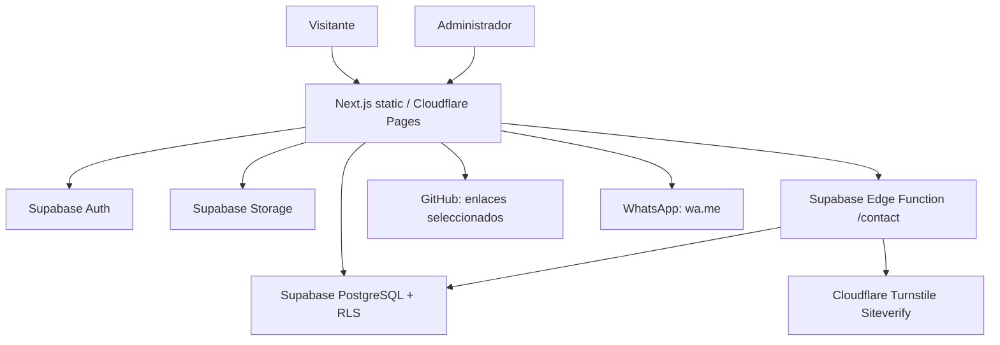

# GALACTIC PORTFOLIO — ARCHITECTURE

**Versión:** 1.1 aprobada. **Tipo:** monolito modular frontend + backend administrado; documento de diseño, NO instrucción de inicio.

## 1. Decisión arquitectónica ADR-001
**Contexto:** un propietario, visitantes anónimos, CRUD privado, catálogo público, presupuesto gratuito, Next.js y Cloudflare Pages.
**Alternativas:** servidor Next.js completo en Vercel/Workers; SPA pura; microservicios.
**Decisión:** Next.js con App Router **exportado estáticamente** (`output: 'export'`) en Cloudflare Pages; contenido vivo consumido desde Supabase; operaciones privilegiadas vía RLS/Edge Function cuando se requiera.
**Consecuencias:** bajo costo y despliegue sencillo; **no depender de server actions, API routes Next.js, middleware de servidor, ISR, SSR ni revalidación on-demand**. Los listados de proyectos se cargan del backend; detalles públicos mediante rutas estáticas con query params, por ejemplo `/proyectos/ver?slug=...`. Para SEO granular futuro evaluar Workers/SSR con ADR nuevo y aprobación.

## 2. Stack y compatibilidad
- Next.js + React + TypeScript (strict). Línea base propuesta del plan: Next.js 16.4.x; **Codex verificará release estable y compatibilidad real al iniciar Sprint 1 y fijará dependencias en lockfile**.
- Tailwind CSS 4, Motion para React, Three.js + React Three Fiber únicamente en hero/escenas justificadas.
- React Hook Form + Zod; Supabase JS cliente; Supabase Auth, PostgreSQL, Storage, Edge Functions.
- Vitest/Testing Library, Playwright; GitHub Actions; Cloudflare Pages.
- No imponer ORM, estado global, Docker, colas, Redis, API REST propia o microservicios sin necesidad demostrada.

## 3. Diagramas de contexto


## 4. Organización de módulos sugerida (no estructura obligatoria preexistente)
```text
src/
  app/                       # rutas estáticas; public/admin agrupados por layouts
  features/
    portfolio/               # catálogo, detalle, filtros
    ideas/                   # listado público y CRUD privado
    admin-auth/              # sesiones y guardas UI
    project-management/      # formularios, publicaciones y medios
    contact/                 # formulario + estados UI
    messages/                # inbox admin
    profile/                 # sobre mí/configuración
  components/ui/             # componentes accesibles reutilizables
  components/space/          # hero, fallbacks de animación
  lib/supabase/              # cliente público (anon/publishable key)
  lib/validation/            # esquemas Zod reutilizables
  lib/security/              # URL validation, permissions helpers
  styles/                    # tokens y estilos globales
supabase/
  migrations/                # DDL, RLS, grants, índices, funciones
  functions/contact/         # Edge Function con Turnstile
  seed/                      # datos ficticios EXPLÍCITOS de desarrollo
  tests/                     # pruebas RLS y contratos
.github/workflows/           # calidad CI sin auto-merge
```
Agrupar pantallas de forma compatible con `output: export`; rutas `/admin/*` son archivos estáticos pero los datos/operaciones siempre están protegidos por Auth + RLS. Nunca considerar la ocultación visual una barrera de seguridad.

## 5. Responsabilidades y flujos
- **UI presentación:** rutas, formularios, carga/errores/vacíos, animaciones, accesibilidad; sin secretos.
- **Features/domain:** mapeo DTO, validaciones, estados y reglas de visibilidad (defensa en profundidad); no copiar autorización de base de datos al cliente como control único.
- **Supabase:** persistencia, permisos de lectura/escritura mediante RLS y grants; identidad auth.uid(); bucket con políticas.
- **Edge Function contact:** único punto público de escritura de mensajes, validación server-side de Turnstile y payload, límites de abuso, respuesta opaca; clave privilegiada SOLO en servidor seguro si se necesita y tras acotar privilegios.

## 6. Contratos de cliente / casos de uso
- `listPublishedProjects({technology?, category?, page?, pageSize?}) -> ProjectCard[]` con paginación razonable, estado publicado forzado por DB.
- `getPublishedProjectBySlug(slug) -> ProjectDetail | NotFound`.
- `listPublicIdeas(...) -> IdeaPublic[]` según visibilidad y estado.
- `adminCreateProject(input)`, `adminUpdateProject(id, patch)`, `adminPublishProject(id)`, `adminArchiveProject(id)` con sesión y RLS.
- `adminCreateIdea(input)`, `adminSetIdeaVisibility(id, isPublic)` con validación de estado.
- `submitContact({name,email,message,turnstileToken}) -> {ok:true} | ApiError` vía Edge Function.
- `adminListMessages({status,page})`, `adminUpdateMessageStatus(id,status)`.
- `uploadProjectImage(file, altText)` con MIME real/tamaño, política y rollback de metadatos ante error.
- Enlaces GitHub: texto externo validado https, dominio `github.com` para repositorios; otros hosts Git opcionales solo tras aprobación.

## 7. Integraciones y errores
- Errores de forma `{"code":"VALIDATION_ERROR|UNAUTHORIZED|FORBIDDEN|NOT_FOUND|RATE_LIMITED|INTERNAL","message":"mensaje seguro"}`; sin payload sensible.
- Reintentos solo en lecturas idempotentes ante fallos transitorios; no reintentar automáticamente contacto con riesgo de duplicados. Idempotencia de contacto opcional vía token de petición si se detecta necesidad real.
- GitHub seleccionado manualmente; no GitHub OAuth/import en MVP.
- WhatsApp URL `https://wa.me/<E164_DIGITS>?text=<urlencoded>`. No integrar API de WhatsApp.

## 8. Datos y seguridad
Ver [DATABASE.md](DATABASE.md). RLS debe permitir solo públicos publicados y admin, nunca acceso directo anónimo a `contact_messages`; políticas de Storage consistentes; no usar `service_role` en navegador. CSP compatible con Supabase, Turnstile y assets de la web; HTTPS.

## 9. Escalabilidad deliberada
- Nuevas features independientes en `features/`; interfaces reutilizables; migraciones incrementales.
- Aplicaciones complejas en repos/repositorios y despliegues independientes enlazados desde portafolio.
- No diseñar multitenancy antes de necesitarlo.
- Si SEO detallado o backend crecen: ADR-002 para pasar a Cloudflare Workers/Next runtime y migrar rutas `?slug=` a rutas limpias; mantener tablas y contratos estables.

## 10. Despliegue y operaciones
- Pull request: checks typecheck, lint, unit, build, E2E cuando el entorno lo permita, DB security tests.
- Deploy preview según permisos proveedor; **no desplegar producción sin autorización explícita**.
- `NEXT_PUBLIC_SUPABASE_URL`, `NEXT_PUBLIC_SUPABASE_ANON_KEY`/publishable key y Turnstile site key son públicos; secrets privados de contact function quedan en entorno seguro. Los nombres exactos se verifican contra SDK vigente.
- Documentar variables, cuotas y procedimiento de rollback (volver build anterior) + backup y restauración.

## 11. ADR pendientes
- **ADR-002:** SSR/Workers solo si se aprueba tras evidencia de requerimientos SEO/dinámicos.
- **ADR-003:** los medios del catálogo se mantienen en un bucket privado. El cliente descarga bajo RLS, que comprueba la publicación del proyecto en cada acceso evaluado por Storage. Se descartó el bucket público porque una URL conocida seguiría funcionando tras despublicar, y se evitó emitir enlaces firmados por su vigencia independiente del estado del proyecto. La comprobación del caché de Storage y las reglas de carga y borrado quedan para la integración y el Sprint 3. Una copia ya descargada puede conservarse fuera del sitio.
