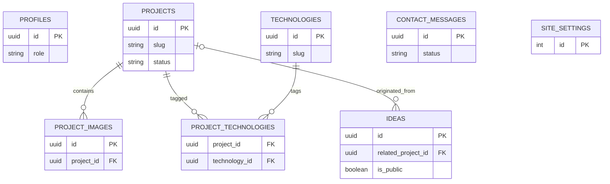

# GALACTIC PORTFOLIO — DATABASE & ACCESS CONTROL

**Motor:** Supabase PostgreSQL. **Estado:** diseño lógico, no migraciones ejecutadas.

## 1. Convenciones
UUID PK (`gen_random_uuid()`), `created_at`/`updated_at` timestamptz, campos obligatorios NOT NULL, `slug` case-insensitive único mediante índice sobre `lower(slug)` cuando aplique, FK e índices coherentes, enums/check constraints documentados y migraciones versionadas. No copiar datos reales a seeds.

## 2. Modelo lógico mínimo

### `profiles`
`id uuid PK FK auth.users(id)`, `role text NOT NULL CHECK (role IN ('admin'))`, `display_name text`, `created_at timestamptz`, `updated_at timestamptz`. En MVP **un admin autorizado por procedimiento manual**, sin autoasignación pública de role.

### `projects`
`id uuid PK`, `slug text UNIQUE NOT NULL`, `title text NOT NULL`, `summary text NOT NULL`, `description text NOT NULL`, `category text`, `status text NOT NULL DEFAULT 'draft' CHECK (status IN ('draft','published','archived'))`, `github_url text NULL`, `demo_url text NULL`, `featured boolean NOT NULL DEFAULT false`, `sort_order integer NOT NULL DEFAULT 0`, `published_at timestamptz NULL`, `created_at`, `updated_at`. Validar URL en aplicación y reglas de base cuando sea adecuado. Al publicar, fijar `published_at`.

### `project_images`
`id uuid PK`, `project_id uuid NOT NULL FK projects(id) ON DELETE CASCADE`, `storage_path text NOT NULL UNIQUE`, `alt_text text NOT NULL`, `sort_order integer NOT NULL DEFAULT 0`, `created_at`. Archivos físicos requieren limpieza controlada separada del FK.

### `technologies`
`id uuid PK`, `slug text UNIQUE NOT NULL`, `name text NOT NULL`, `icon_key text NULL`, `created_at`.

### `project_technologies`
`project_id uuid FK projects(id) ON DELETE CASCADE`, `technology_id uuid FK technologies(id) ON DELETE RESTRICT`, `PRIMARY KEY (project_id,technology_id)`.

### `ideas`
`id uuid PK`, `slug text UNIQUE NOT NULL`, `title text NOT NULL`, `summary text NOT NULL`, `body text NOT NULL`, `status text NOT NULL DEFAULT 'draft' CHECK (status IN ('draft','in_progress','converted','archived'))`, `is_public boolean NOT NULL DEFAULT false`, `related_project_id uuid NULL FK projects(id) ON DELETE SET NULL`, `created_at`, `updated_at`, `published_at timestamptz NULL`. Política pública: **`is_public=true AND status IN ('in_progress','converted')`**. No mostrar `draft` ni `archived`.

### `contact_messages`
`id uuid PK`, `name text NOT NULL`, `email text NOT NULL`, `message text NOT NULL`, `status text NOT NULL DEFAULT 'new' CHECK (status IN ('new','read','archived'))`, `created_at timestamptz NOT NULL DEFAULT now()`, `read_at timestamptz NULL`. No guardar IP/huella del usuario por defecto; si la protección lo requiere, justificar retención y privacidad.

### `site_settings`
`id integer PK CHECK (id=1)` (singleton), `site_name text NOT NULL`, `hero_heading text`, `hero_description text`, `bio text`, `github_profile_url text`, `whatsapp_e164 text`, `contact_email text`, `updated_at`. Lectura pública **solo campos públicos**; si se añaden secretos/configuración privada, separarlos físicamente.

## 3. Relaciones

## 4. Permisos previstos (RLS + GRANTS)
| Recurso | anon | authenticated no-admin | admin |
|---|---|---|---|
| projects | SELECT solo published | Igual | CRUD completo |
| project_images | SELECT solo de proyecto published | Igual | CRUD |
| technologies | SELECT | SELECT | CRUD |
| project_technologies | SELECT solo asociación pública | Igual | CRUD |
| ideas | SELECT solo públicas con estado válido | Igual | CRUD |
| contact_messages | **sin SELECT ni INSERT directo** | ninguno | SELECT/UPDATE/DELETE controlados |
| site_settings | SELECT solo datos públicos | Igual | UPDATE |
| profiles | sin exposición | solo identidad propia si procede | admin para rol propio |

**Reglas críticas:**
1. Habilitar RLS en **todas** las tablas expuestas.
2. Definir función o política `is_site_admin()` segura basada en `auth.uid()` y tabla `profiles`, con `search_path` fijo si es security definer; evitar recursión RLS y grants excesivos.
3. Prohibir que un usuario se autoconceda rol `admin` por registro o actualización de perfil.
4. Ejecutar tests SQL con contexto anon, authenticated no-admin y admin.
5. **No otorgar INSERT a anon/authenticated sobre `contact_messages`.** Solo Edge Function verifica Turnstile, valida contenido y escribe con credenciales protegidas y operación limitada; elegir mecanismo de privilegio mínimo en implementación.
6. Selección pública de imágenes debe estar condicionada a visibilidad del proyecto; evaluar bucket público solo para imágenes explícitamente publicadas, bucket privado para borradores. No usar un bucket totalmente público para material privado.
7. No exponer `auth.users`, credenciales o email administrativo por defecto.

## 5. Índices propuestos
`projects(status, featured, sort_order)`, `projects(lower(slug)) UNIQUE`, `ideas(is_public,status,published_at)`, `ideas(lower(slug)) UNIQUE`, `project_images(project_id,sort_order)`, `contact_messages(status,created_at DESC)`, índices de FK en relaciones, `technologies(lower(slug)) UNIQUE`. Validar su utilidad con consultas reales; no sobreindexar.

## 6. Validaciones y límites (ajustables en Sprint 2/3)
- Título <= 160 caracteres; slug 3–100 y `[a-z0-9-]`; resumen <= 500; longitud máxima de descripción razonable documentada.
- Contacto: nombre 2–120; email válido <= 254; mensaje 10–5000; no almacenar HTML activo.
- Imágenes: JPEG/PNG/WebP/AVIF según soporte verificado; máximo recomendado 5 MB por archivo; MIME y firma validados cuando corresponda, nombres aleatorios, alt obligatorio.
- Enlaces: HTTPS seguro; GitHub `github.com` para repos seleccionados, demos a HTTPS; prevenir `javascript:` y otros protocolos.
- El cliente valida por experiencia; la seguridad se repite en DB/function.

## 7. Migraciones, conservación y recuperación
- Orden: tablas + constraints → índices → RLS/grants → funciones/policies → buckets y policies → pruebas.
- Migraciones pequeñas, reproducibles, revisables en PR; nunca ejecutar borrados destructivos en producción sin respaldo y aprobación.
- Backups: definir exportaciones independientes de esquema/datos y de archivos; verificar restauración en entorno de prueba al menos antes de lanzamiento. **El plan Free no debe considerarse un backup automático**.
- Conservar mensajes por plazo a definir con propietario; habilitar eliminación segura; documentar cumplimiento de aviso de privacidad.
- Registrar cualquier cambio de campos/estados en un ADR y actualizar contratos, tests y UI.
